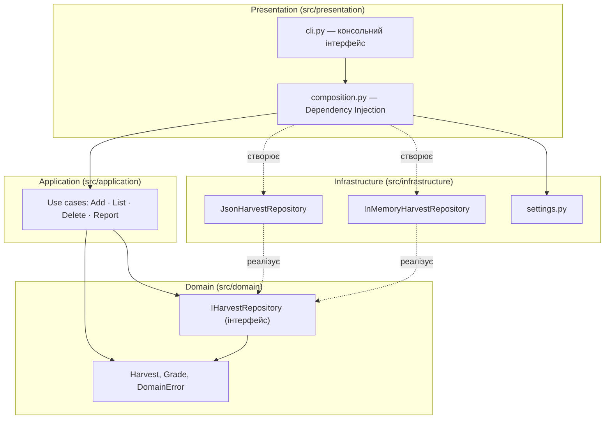

# Облік урожаю

Консольний застосунок для обліку врожаю, зібраного з полів: додавання записів
(культура, поле, дата, вага, сортність), перегляд з фільтрами, видалення та
підсумковий звіт по культурах.

Лабораторна робота №5 «Побудова архітектури застосунку. Робота з Git»
(дисципліна «Сучасні технології проєктування»). Python 3.9+, без зовнішніх залежностей.

## Архітектура (Clean Architecture)



Залежності спрямовані **всередину**: Presentation → Application → Domain,
Infrastructure → Domain. Domain нічого не знає про інші шари.

```
src/
├── domain/                 # сутності та правила, інтерфейси (порти)
│   ├── entities/harvest.py            Harvest, Grade
│   ├── interfaces/harvest_repository.py   IHarvestRepository
│   └── errors.py
├── application/use_cases/  # сценарії; працюють лише через IHarvestRepository
│   ├── add_harvest.py  list_harvests.py  delete_harvest.py  harvest_report.py
├── infrastructure/         # реалізації: JSON-файл, пам'ять, читання конфігурації
│   ├── repositories/json_repository.py, in_memory_repository.py
│   └── settings.py
└── presentation/           # точка входу
    ├── cli.py              консольний інтерфейс
    └── composition.py      збирання залежностей (DI)
```

## Збірка та запуск

Збірка не потрібна (Python-проєкт без залежностей).

```bash
git clone <URL-репозиторію> && cd harvest-accounting
python -m unittest discover -s tests -t .          # тести

python -m src.presentation add --crop Пшениця --field "Поле 1" --weight 1500 --date 2026-08-01
python -m src.presentation add --crop Кукурудза --field "Поле 2" --weight 3200 --grade 2
python -m src.presentation list [--crop Пшениця] [--field "Поле 1"]
python -m src.presentation report
python -m src.presentation delete <id>
```

Дані зберігаються у `data/harvests.json`. Спосіб збереження задається в
`appsettings.json` (`"type": "json"` або `"memory"`); use cases при цьому не змінюються.

## Гілкування

* `main` — стабільний код (теґи релізів), `develop` — інтеграційна гілка,
  `feature/*` — гілки під конкретні задачі (по одній на шар).
* Коміти за Conventional Commits: `feat`, `fix`, `refactor`, `test`, `docs`, `chore`.
